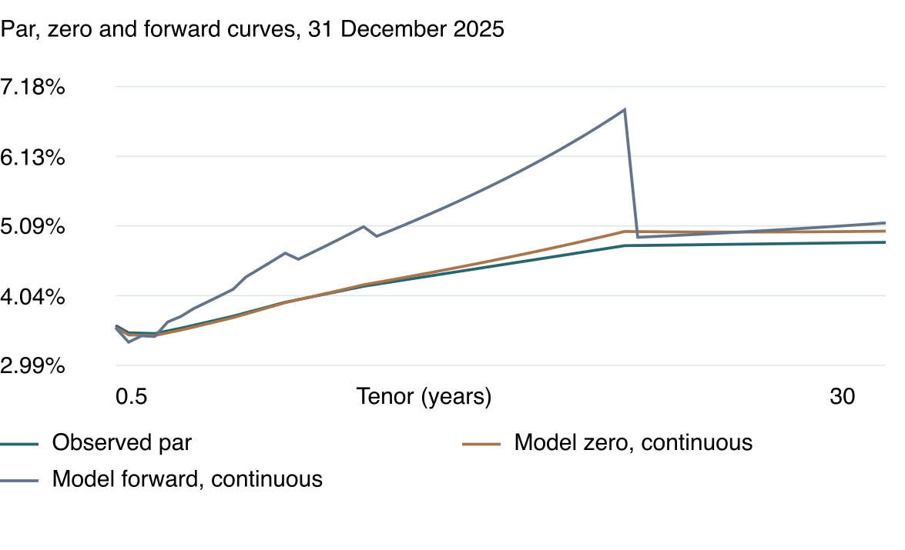

# Fixed Income Curve and Risk Lab

**Treasury par yields → hypothetical cash flows → key-rate risk → challenged hedges.**

[Live dashboard](https://thvh2006.github.io/fixed-income-curve-risk-lab/) · [Research paper](deliverables/P4_Research_Report.pdf) · [Excel workbook](deliverables/P4_Curve_Risk_Workbook.xlsx) · [Two-page method note](deliverables/P4_Method_Note.pdf) · [Executed notebooks](notebooks/)

Release **1.0.0** · Frozen research **2 Jan 2024–31 Dec 2025** · 499 official Treasury daily observations · English research deliverables.

**Validation:** 27 unit tests, 6,060 frozen-release checks, 42 independent Excel comparisons, 36 browser yield cases and 27 browser curve/accrual/YTM cases.

This laboratory asks how curve construction and key-rate exposure change a bond valuation and hedge decision. It also tests whether train-only curve-factor forecasts improve on a no-change reference. Published Treasury **par/CMT rates are observed**; zero/forward curves, dated bond prices, portfolios and all allocation returns are **model-implied**. There are no actual-security quote or trading-performance claims.



## What the evidence says

- The educational bootstrap reprices its idealised par instruments to numerical precision. This identity does not validate a traded bond price.
- A 4% hypothetical bond due 31 Dec 2030 has a model dirty price of **101.215533 per 100 face** at 31 Dec 2025. Clean/dirty, accrued interest and YTM are explicit.
- A duration-matched bullet and barbell have different twist exposures. The bounded 2/10-year hedge reduces key-rate L2 risk only slightly; the remaining 5-year exposure is shown. A separate parallel-DV01-neutral hedge illustrates why scalar neutrality can increase key-rate risk.
- In the retrospective 2025 forecast study, aggregate RMSE is **9.40 bp for no-change**, **10.68 bp for PCA/AR** and **9.41 bp for ridge-change**, over 49 five-observation target windows. No challenger is promoted.
- A cash-flow-level carry/roll-down bridge reconciles coupons, dirty values, financing and assumed costs. Constant-maturity allocation is evaluated separately with rebuilding costs.

## A five-minute review

| Reader task | Open | What to change or inspect |
| --- | --- | --- |
| Understand the decision | [Dashboard](https://thvh2006.github.io/fixed-income-curve-risk-lab/) | Curve observatory, then Stress and hedge |
| Challenge a price | [Bond pricer view](https://thvh2006.github.io/fixed-income-curve-risk-lab/#bond-pricer) | Coupon, settlement, maturity, parallel zero shock; inspect every discounted cash flow |
| Audit independent formulas | [Workbook](deliverables/P4_Curve_Risk_Workbook.xlsx) | Inputs → Bond Schedule → Price and Risk → Key Rate Risk; native sensitivity on Inputs |
| Review mathematics | [Notebook 02](notebooks/02_bond_cashflows_and_pricing.ipynb), [04](notebooks/04_duration_convexity_keyrates.ipynb) | Par/zero analytical cases, accrued dates, yield round trip and finite differences |
| Review negative evidence | [Notebook 07](notebooks/07_curve_factor_forecasting.ipynb) | All candidates, train-only fits, baseline, model-implied decision value |
| Trace or reproduce | [Reproducibility guide](docs/reproducibility.md) | Source hashes, build commands, environment and release manifest |

## Run the core research

Python 3.11+ and NumPy are sufficient for the mathematics, build, tests and verifier. No credentials or paid data are required. The public CSVs are small official US government rate observations.

```bash
python -m venv .venv
source .venv/bin/activate
python -m pip install -r requirements-core.txt
python -m unittest discover -s tests -v
python scripts/verify.py
node scripts/check_dashboard.cjs
```

To regenerate the canonical research and interactive page:

```bash
python scripts/build.py
python scripts/build_dashboard.py
python scripts/build_notebooks.py
python scripts/run_notebooks.py
python -m http.server 8000
```

Open `http://localhost:8000`. The notebooks use a fresh Python namespace per file, capture rich HTML/PNG outputs and also support normal IPython display. The supplied sequential executor is **not** a native Jupyter-kernel execution claim. Report and workbook authoring require additional tooling; see [the guide](docs/reproducibility.md). Published files can be reviewed without that tooling.

## What is implemented

| Layer | Implementation and evidence |
| --- | --- |
| Data | Official 2024/2025 CSVs, exact source hashes, strict date/tenor checks, no core imputation, separate current-market receipt |
| Pricing | EOM-aware regular semiannual cash flows, Actual/Actual ICMA accrued interest and yield periods, Actual/365 curve time, clean/dirty, bracketed YTM |
| Curves | Idealised semiannual par bootstrap, log-discount baseline, linear-discount challenger, Nelson-Siegel par-residual fit, positivity and no-extrapolation checks |
| Risk | Yield duration/convexity, continuous-zero finite differences, six key-rate hats, full repricing, matched-duration portfolios, bounded hedge and duration-neutral counterexample |
| Returns | Fixed-holding coupon/cash ledger and ordered carry/roll/move bridge; separate costed constant-maturity illustration |
| Forecasting | Expanding train-only PCA/AR, fixed ridge-change, no-change baseline, 49 non-overlapping targets, future-data mutation challenge |
| Excel | 15 readable sheets; independent curve, dated schedule, YTM, risk and live coupon/shock sensitivity; imported historical outputs labelled |
| Interface | Eight views, 499 selectable historical dates, independent bond calculator, invalid/blank states, keyboard navigation and decision JSON export |
| Communication | Academic TNR 12-point paper, editable DOCX, two-page method note, eight executed notebooks and source-linked evidence map |
| Operations | CI, scheduled EOD market receipt, last-known-good failure retention, regression rejection, atomic publication and rollback runbook |

## Scope and limits

The curve is an **educational reconstruction from published par yields**, not Treasury's production monotone-convex implementation or a calibrated set of actual CUSIPs. Hypothetical coupons are regular and unadjusted; stubs, legal holiday payment handling, ex-coupon conventions, credit/default/liquidity, OIS, swaps and futures CTD are outside scope. No curve extrapolation is allowed. The two-year historical sample was retrieved in November 2026 and has no vintage archive.

Forecasts and model-implied returns are retrospective. The cost assumptions are not executable quotes. Portfolio stress is instantaneous full repricing; overlay funding, short-locate availability and market impact are not observed. Do not interpret the hosted page as a streaming rate feed. EOD market refresh operates separately from the frozen research and cannot silently change its findings.

[Conventions and model card](docs/model_card.md) · [Claim–evidence map](docs/evidence_map.md) · [Workbook guide](docs/workbook_guide.md) · [Runbook](docs/runbook.md) · [Release notes](docs/RELEASE_NOTES.md)

Original code is MIT licensed. Source rate facts retain Treasury attribution; no government seals, third-party figures, fonts or proprietary security datasets are redistributed.
